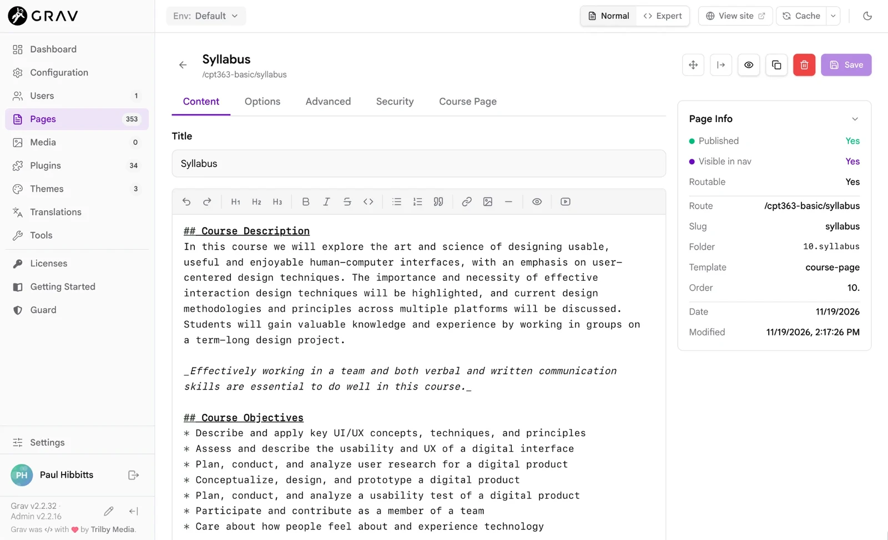

[← Open Courses](/open-course-hub/README.md)

# Getting Started

<small>Part 6</small>

All the starters and converters in this guide are **free and open-source**, and you can explore the demos and try the converter with nothing to install:

- **"I want a web home for my course – or several"** → Open Course Space: [demo](https://demo.hibbittsdesign.org/grav-open-course-space/) · [download](https://getgrav.org/downloads/skeletons#open-course-space-site) (an early preview)
- **"I already have a course in my LMS"** → the [Common Cartridge Converter](https://grav-common-cartridge-converter.hibbittsdesign.org/)
- **"No web server? Start with Docsify"** → [Docsify-This](https://docsify-this.net/) or a [Docsify Starter Kit](https://hibbittsdesign.org/docsify-starter-kits.html), then the [Grav Docsify Bridge](https://grav-docsify-bridge.hibbittsdesign.org/) when you're ready for a full site – see the [Docsify](docsify/README.md) guide
- **"I want to share a textbook or guide"** → its twin, Open Publishing Space – see the [Open Textbooks and Guides](open-publishing-space/README.md) guide

**Explore it in 5 minutes,** on [the original version of this page](https://share-move-reuse.hibbittsdesign.org/open-course-hub/getting-started):

1. **Add** `.md` to this page's address to see its Markdown
2. **Press** ← and → to move through this guide, like slides
3. **Add** `?embedded=true` to this page's address to see it as it would appear in your LMS
4. **Sign in** to the [read-only Admin 2 demo](https://try.hibbittsdesign.org/grav-skeleton-open-course-space/admin) and open a module page to see its Markdown

Then set up your own site:

1. **Download** [Open Course Space](https://getgrav.org/downloads/skeletons#open-course-space-site) from getgrav.org (it's an early preview)
2. **Upload** it to your web host and unzip it (your host's file manager can do this), then open the site
3. **Open** Admin 2 by adding `/admin` to the site's address, set up your account, then follow **Getting Started** in its sidebar – the Sample Course is ready to start your own from

*Editing a course page in Admin 2 – plain Markdown, right in the browser*

**Where to host:** many institutions offer web space for staff and students (often called a Domain of One's Own), and most low-cost web hosts run [PHP](/open-course-hub/glossary.md "The programming language Grav runs on. Most web hosts include it.") 8.3 or newer.

**See it moved:** this same guide also runs, with the same content, on [the Quark 2 theme](https://share-move-reuse.hibbittsdesign.org/open-course-hub) and [the classic Quark theme](https://demo.hibbittsdesign.org/share-move-reuse/share-move-reuse-ops-quark/open-course-hub), as an [Open Course Space course](https://demo.hibbittsdesign.org/share-move-reuse/share-move-reuse-ocs/open-course-hub), and on Grav Premium Helios as an [open reader](https://demo.hibbittsdesign.org/share-move-reuse/share-move-reuse-hor/open-course-hub) and a [course hub](https://demo.hibbittsdesign.org/share-move-reuse/share-move-reuse-hch/open-course-hub).

> [!IMPORTANT]
> **Good to know:** an open course site works alongside your LMS rather than replacing it – there are no grades, quizzes or enrolment. You'll need a PHP web host (no database), and Grav extras like definition and objectives boxes are [shortcodes](/open-course-hub/glossary.md "A short tag in square brackets that Grav turns into a box, an embed or another feature when it shows a page.") that other tools would need converted. If you ever lose access to a web host, the free [Grav Docsify Bridge](https://grav-docsify-bridge.hibbittsdesign.org/) turns your course into a Docsify-This site, with no web server needed.

With thanks to the authors of the openly licensed course used as an example, for sharing their work in the open 🙏🏻

**Share this guide:** [share-move-reuse.hibbittsdesign.org/open-course-hub](https://share-move-reuse.hibbittsdesign.org/open-course-hub) – licensed [CC BY 4.0](https://creativecommons.org/licenses/by/4.0/), so you can copy it, adapt it and share it, with credit, or [get it all as one Markdown file](https://share-move-reuse.hibbittsdesign.org/open-course-hub/llms-full.txt).

Questions or ideas? [Get in touch](https://hibbittsdesign.org/contact.html) – Paul Hibbitts, [hibbittsdesign.org](https://hibbittsdesign.org/)
